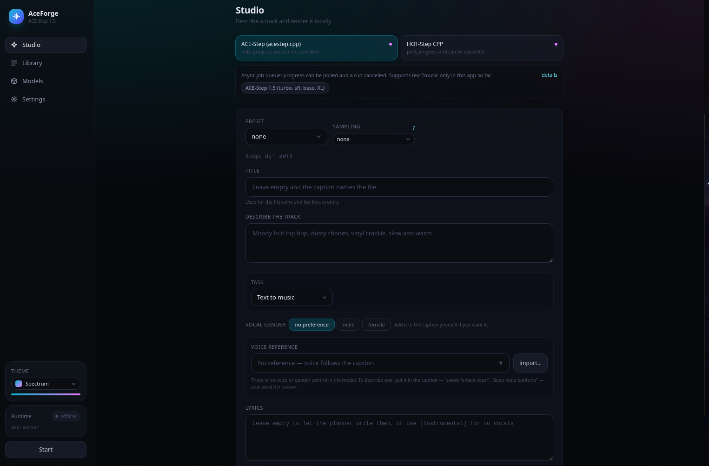

<div align="center">

# AceForge

**Local music generation with ACE-Step. Nothing leaves your machine.**

[](https://github.com/DjagbleyEmmanuel/AceForge/releases/latest)


</div>

AceForge drives the ACE-Step family of models on your own hardware: you describe
a track, it writes the lyrics and renders the audio. There is no account, no
server, and no network call after the models are on disk.



## What it does

- **Text to music** with a style description; the planner writes the lyrics
- **Vocals, or `[Instrumental]`** for none
- **Voice reference** — imitate a voice from a clip you supply
- **Synced lyrics** — a `.lrc` is written beside each track, and the player
  follows along
- **Source-based tasks** — repaint a section, cover, extract or add a stem,
  complete one — against a track you supply
- **Crop, normalise and master** finished renders, without re-rendering
- **Two engines**, one HTTP surface: the bundled `acestep.cpp`, and HOT-Step CPP
- **Three model families** — ACE-Step 1.5, YuE2 and MiniMax-Music3

A render is queued, runs in the background, and reports progress and stage while
it goes. The window stays responsive.

## Requirements

| | |
|---|---|
| OS | Linux, x86-64 (built and tested on Ubuntu 24.04) |
| GPU | NVIDIA with CUDA. Developed on a GTX 1050, **4 GB** |
| RAM | 24 GB |
| Disk | 1 GB for the app; models are far larger |

The 4 GB card is the real constraint. Everything below is tuned for it: the
planner runs one song at a time, and multi-song output is driven from the
render stage, which was measured to fit where the planner does not.

## Install

Grab the `.deb` from [releases](https://github.com/DjagbleyEmmanuel/AceForge/releases/latest):

```bash
sudo dpkg -i AceForge_<version>_amd64.deb
```

Stop the app first if it is running — `pkill -x AceForge` — or `dpkg` will hit a
held binary.

The package ships the engines but **not** the models, which are several GB. Point
the app at your weights folder in **Settings**, or use the **Models** tab to see
what it expects.

## Models

Weights are not redistributed. Set a models folder and the app will list what it
finds, or tell you what is missing.

| Family | Needs |
|---|---|
| ACE-Step 1.5 | four GGUFs — LM, text encoder, DiT, VAE |
| YuE2 | an LM and a VAE, under a `yue2/` subfolder |
| MiniMax-Music3 | GGUFs under an `mm3/` subfolder |

Turbo, SFT and XL are variants of the DiT; the LM comes in 0.6B, 1.7B and 4B.
The 0.6B planner is measurably weaker at lyrics, and the app says so where you
pick it.

## The two engines

| | acestep | hotstep |
|---|---|---|
| Families | ACE-Step 1.5 (turbo, sft, base, XL) | ACE-Step 1.5, YuE2, MiniMax-Music3 |
| Tasks | text2music (see below) | text2music, repaint, cover, stems, extraction |
| Solvers | built in | Lua plugins |
| Adapters | one DiT slot | its own adapter slots, and a companion slot |

HOT-Step is a further-developed `acestep.cpp` with the same HTTP surface, so
progress and cancel behave identically. It needs its own models folder and is
adopted separately at first launch.

The bundled engine parses the task type but the app describes it as text2music
only for now, so reach for HOT-Step when you want the source-based tasks. That
description is the conservative one; it is not a claim that the others fail.

More detail in [ENGINE.md](ENGINE.md), including two traps that are expensive to
rediscover: HOT-Step's solver plugins must keep their subdirectories, and the
solver arrives under a different key on a different request than you would
guess.

## Building from source

Needs Node, Rust, and the NVIDIA/CUDA toolkit.

```bash
git clone https://github.com/DjagbleyEmmanuel/AceForge
cd AceForge
npm install
./scripts/fetch-resources.sh     # restores the engine binaries .gitignore excludes
npm run tauri build -- --bundles deb
```

The fetcher copies from local source trees rather than downloading, so point it
somewhere with `ACESTEP_SRC`, `HOTSTEP_SRC` and `HOTSTEP_PLUGINS` if yours
differ. See the script for the defaults.

The engine binaries are build output and are excluded from git — they are past
GitHub's 100 MB per-file limit, and a clone cannot bundle until the fetcher has
run.

### CUDA

`CMAKE_CUDA_ARCHITECTURES=61` for Pascal (GTX 1050). CUDA 13 dropped `sm_61`;
use 12.6.

## Known limits

- **YuE2's audio stage needs about 4.6 GB** and will not fit on a 4 GB card.
  Planning works, and the panel says so before you start.
- A render is one take at a time. Nothing here is tuned for a small card beyond
  what fits.
- MiniMax weights download and classify, but there is no generate form for it
  yet.
- Synced lyrics for a YuE2 render are laid out evenly across the track, not
  measured. The composer does not return timed lyrics and its score carries no
  words, so there is nothing to measure against.

## Licence

None. All rights reserved by default — see [the repository settings][lic] if you
want to change that. The bundled engines and libraries keep their own licences.

## Development

`HANDOFF.md` is a session handoff for anyone working on this: hardware limits,
what has been fixed, and what is still wrong. It is written to be read cold.

```bash
cargo test --offline --manifest-path src-tauri/Cargo.toml
npx tsc --noEmit
```

There is no JavaScript test runner — frontend correctness is types plus reading.

[lic]: https://github.com/DjagbleyEmmanuel/AceForge